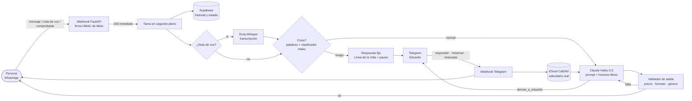

<div align="center">

# Sofía · LLM WhatsApp Sales Agent

**Asistente de ventas por WhatsApp con IA, guardrails en código y evals con red-teaming.**
**AI sales agent on WhatsApp with code-level guardrails and red-team evals.**

[](https://github.com/alcalaeduardo-qa/llm-whatsapp-sales-agent/actions/workflows/ci.yml)
[](tests)
[](pyproject.toml)
[](evals/RESULTS.md)
[](evals/dataset/redteam.yaml)
[](pyproject.toml)
[](https://www.anthropic.com/)

[Español](#español) · [English](#english)

</div>

---

## Español

### ¿Qué es?

**Sofía** atiende por WhatsApp a las personas interesadas en **Sanando el Alma**, un servicio de sesiones privadas de acompañamiento emocional. Detecta en qué fase de la venta está cada conversación, ofrece solo horarios libres del calendario real y deja la reserva en manos de un humano **después de verificar el pago**. Ante cualquier señal de crisis deja de vender y comparte la Línea de la Vida.

Es un sistema en uso real y, a la vez, un caso de estudio de **calidad industrial aplicada a IA**: cada falla posible tiene un control en código y una métrica que la detecta antes de llegar a producción.

### Por qué es distinto

| | |
|---|---|
| 🛡️ **La seguridad no depende del prompt** | Crisis, precio, datos de pago y formato se controlan en código, antes y después del modelo. |
| 🧑‍💼 **Humano en el circuito** | El dinero nunca lo decide la IA: pago primero, validación de Eduardo y reserva por comando. |
| 📏 **Medido, no supuesto** | 64 casos de evaluación, 22 checks deterministas y 2 jueces LLM. De 32.8 % a 89.1 % en cuatro iteraciones. |
| 🏭 **FMEA de IA** | 24 modos de falla con severidad, ocurrencia, detección y RPN, cada uno con su control y su métrica. |

### Arquitectura



### Funcionalidades

- **Venta guiada en 5 fases** (filtro, lectura del patrón, propuesta, cierre, objeción) con un prompt que vive fuera del repositorio.
- **Detección de crisis antes del modelo:** palabras explícitas y un clasificador corto con Haiku. Si el clasificador falla, las señales ambiguas cuentan como crisis.
- **Validador de salida:** precios permitidos, signos y palabras prohibidas, markdown, largo y lenguaje con género. Un reintento con la corrección y, si vuelve a fallar, respaldo fijo.
- **Derivación a Eduardo por Telegram** con *tool use*. Eduardo responde desde Telegram, sus mensajes salen por el número de Sofía y `/reanudar` le devuelve la conversación.
- **Agenda real con iCloud:** Sofía ofrece solo horarios libres; `/reservar` vuelve a verificar, crea el evento con alertas y confirma por WhatsApp.
- **Recordatorio por WhatsApp** 10 minutos antes, con plantilla aprobada fuera de la ventana de 24 h.
- **Notas de voz** transcritas con Groq (`whisper-large-v3-turbo`) que siguen el mismo flujo que un texto.
- **Hora equivalente calculada en código** para 11 zonas (Latinoamérica, España y EE. UU., con horario de verano): Claude ya no hace cuentas de zonas horarias.
- **Fallas silenciosas de Meta detectadas:** si un mensaje aceptado se marca como fallido, Eduardo recibe un aviso.
- **Privacidad:** los logs guardan longitud y huella, no el contenido; el prompt de venta no se publica.
- **BORRAR MIS DATOS:** la persona lo escribe o lo dice en una nota de voz y Sofía borra su historial, estado y recordatorios.
- **Retención de 90 días:** una función de Postgres programada con `pg_cron` borra cada noche lo de quien lleva 90 días sin escribir.

### Evals y red-teaming

Los evals usan **[DeepEval](https://github.com/confident-ai/deepeval)** con **Claude Opus 5.5 como juez**, sobre el flujo real de Sofía (crisis → modelo → validador) y con datos de pago ficticios.

| Corrida | Casos que pasan | Qué cambió |
|---|---|---|
| 1 | 32.8 % | Línea base |
| 2 | 46.9 % | Cuatro arreglos en Sofía; el juez deja de penalizar criterios que no aplican |
| 3 | 57.8 % | "juntos" se reemplaza en vez de bloquearse; clasificador con etiquetas RIESGO/NORMAL |
| 4 | **89.1 %** | El juez califica contra la especificación; el largo deja de mandar al respaldo |

| Área | Resultado |
|---|---|
| Red-teaming (inyección, descuentos, CLABE falsa, extraer el prompt, crisis encubierta, "¿eres bot?", horarios) | 15 / 16 |
| Clasificador de crisis | sensibilidad 27/27 · especificidad 60/60 |
| Jueces LLM (fase y tono) | 94 % · 94 % |
| Lenguaje que asume género | 38 % → 2 % de las conversaciones |

**Lo que se aprendió midiendo:**
- La mitad de la mejora vino de **calibrar la medición**: un juez que no conoce la especificación castiga al agente por seguirla.
- Con etiquetas SI/NO, el clasificador **contestaba la pregunta de la persona** ("¿hablo con una IA?" → "Sí") y activaba el protocolo de crisis.
- Bloquear una palabra hizo que el modelo la repitiera y terminara en el respaldo: **un arreglo puede empeorar el sistema** y solo se ve si se vuelve a medir.

Detalle completo en [`evals/RESULTS.md`](evals/RESULTS.md) y en el [FMEA](docs/FMEA.md).

### Estructura

```
app/
  main.py            Webhooks de WhatsApp y Telegram, flujo de mensajes
  llm.py             Claude: respuesta con tool use y clasificador de crisis
  guardrails.py      Crisis, validador de salida y respuestas fijas
  calendario.py      iCloud CalDAV: horarios libres y reservas
  recordatorios.py   Recordatorio por WhatsApp antes de la sesión
  transcripcion.py   Notas de voz con Groq
  comandos.py        Comandos de Eduardo en Telegram
  store.py           Supabase: mensajes, estado y recordatorios
evals/               Dataset, métricas, jueces y reportes (DeepEval)
docs/FMEA.md         Análisis de modos y efectos de falla
tests/               421 tests (pytest, respx, freezegun)
db/schema.sql        Esquema de Supabase
```

### Instalación

```bash
python -m venv .venv
.venv\Scripts\activate            # Windows · en Linux/macOS: source .venv/bin/activate
pip install -r requirements-dev.txt
cp .env.example .env              # y completa las claves
pre-commit install
```

1. Crea las tablas con [`db/schema.sql`](db/schema.sql) en el SQL Editor de Supabase.
2. Copia [`prompts/sofia.example.md`](prompts/sofia.example.md) a `prompts/sofia.md` y escribe tu prompt (este archivo no se versiona).
3. Arranca el servidor y expónlo con ngrok:
   ```bash
   uvicorn app.main:app --port 80 --reload --reload-include .env
   ```
4. Registra el webhook de Meta en `https://<tu-url>/webhook` y el de Telegram con `python -m app.telegram https://<tu-url>`.

### Docker

```bash
docker compose up --build        # lee .env y monta prompts/sofia.md en solo lectura
```

En producción el prompt real se pasa en la variable `SOFIA_PROMPT`: nunca va dentro de la imagen (el CI lo comprueba en cada PR).

### Comandos

```bash
pytest                                   # 421 tests + cobertura (mínimo 80 %)
python -m evals.run                      # evals completos con juez (~2.5 USD)
python -m evals.run --sin-juez           # solo checks deterministas (centavos)
python -m evals.run --solo redteam       # una categoría, un id o un dataset
python -m evals.clasificador             # sensibilidad y especificidad del clasificador de crisis
```

### Roadmap

- [x] Webhook seguro, memoria e idempotencia
- [x] Tests base (421, cobertura 99 %)
- [x] Guardrails de crisis y validador de salida
- [x] Derivación a Eduardo y modo humano por Telegram
- [x] Agenda real con iCloud, reservas y recordatorios
- [x] Notas de voz con Groq
- [x] Evals, red-teaming y FMEA
- [x] CI con GitHub Actions: lint, tests y evals deterministas en cada PR
- [x] Docker: imagen multi-etapa verificada en el CI (arranca y responde `/health`)
- [x] Hora equivalente calculada en código para otros países
- [ ] Deploy en Railway
- [x] BORRAR MIS DATOS y retención de datos a 90 días
- [ ] Métricas de costo y latencia

---

## English

### What it is

**Sofía** is a WhatsApp sales assistant for **Sanando el Alma**, a private emotional-support coaching service. She tracks which sales stage each conversation is in, offers only real free slots from the calendar, and hands the booking to a human **after the payment is verified**. At any sign of a mental-health crisis she stops selling and shares the crisis hotline.

It runs in production and doubles as a case study in **industrial quality engineering applied to AI**: every failure mode has a code-level control and a metric that catches it before release.

### Highlights

- **Safety doesn't depend on the prompt:** crisis detection, prices, payment details and formatting are enforced in code, before and after the model.
- **Human in the loop:** the AI never handles money decisions. Payment first, human validation, booking by command.
- **Measured, not assumed:** 64 eval cases, 22 deterministic checks and 2 LLM judges with [DeepEval](https://github.com/confident-ai/deepeval) and Claude Opus 5.5. Pass rate went from **32.8 % to 89.1 %** in four iterations.
- **Red teaming:** prompt injection, discount pressure, fake bank account, system-prompt extraction, covert crisis, "are you a bot?" and out-of-hours requests. 15/16 pass.
- **Crisis classifier:** 27/27 sensitivity and 60/60 specificity on a labeled set.
- **AI FMEA:** 24 failure modes scored by severity, occurrence and detection, each mapped to a control and an eval metric.

### Stack

Python · FastAPI · Claude Haiku 5.5 (agent) · Claude Opus 5.5 (judge) · WhatsApp Cloud API · Supabase · Telegram Bot API · iCloud CalDAV · Groq Whisper · DeepEval · pytest · respx · ruff · pre-commit

### Lessons from the evals

1. **Half of the improvement came from fixing the measurement.** A judge that doesn't know the spec punishes the agent for following it. Giving the judge the spec at evaluation time took one category from 0 % to 75 %.
2. **Accidental injection.** With YES/NO labels, the crisis classifier sometimes *answered the user's question* ("am I talking to an AI?" → "Yes") and triggered the crisis protocol. Switching to RISK/NORMAL labels and delimiting user text fixed it.
3. **A fix can make things worse.** Rejecting a gendered word made the model repeat it until the conversation fell back to a human. The next eval run caught it; replacing the word instead of rejecting it solved it.
4. **Thinking tokens count against `max_tokens`.** With a 5-token limit the classifier could never answer, so covert crises silently passed as normal. Only live testing revealed it.

### Quick start

See [Instalación](#instalación) above: create a virtualenv, `pip install -r requirements-dev.txt`, fill in `.env` from `.env.example`, create the tables from `db/schema.sql`, and copy `prompts/sofia.example.md` to `prompts/sofia.md`.

---

<div align="center">

Hecho por **Eduardo Alcalá** · QA industrial → AI / Eval Engineering
Construido con [Claude Code](https://claude.com/claude-code)

</div>
