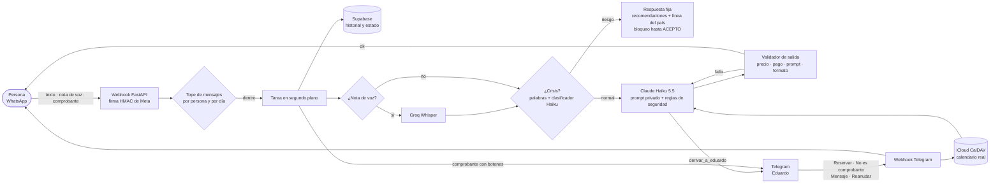

<div align="center">

# Sofía · LLM WhatsApp Sales Agent

**Asistente de ventas por WhatsApp con IA, guardrails en código, humano en el circuito y evals con red-teaming.**
**AI sales agent on WhatsApp with code-level guardrails, a human in the loop and red-team evals.**

[](https://github.com/alcalaeduardo-qa/llm-whatsapp-sales-agent/actions/workflows/ci.yml)
[](tests)
[](pyproject.toml)
[](evals)
[](evals/dataset/redteam.yaml)
[](pyproject.toml)
[](https://www.anthropic.com/)
[](LICENSE)

[English](#english) · [Español](#español)

</div>

---

## What this project demonstrates · Qué demuestra

> Industrial QA applied to AI: failure-mode analysis, 562 tests and evals that gate every change.
> QA industrial aplicado a IA: análisis de modos de falla, 562 tests y evals que frenan cada cambio.

| Skill | Evidence |
|---|---|
| **LLM evaluation** | 69 cases with [DeepEval](https://github.com/confident-ai/deepeval): deterministic checks plus LLM judges. Pass rate 32.8 % → 94 %. |
| **LLM-as-a-judge** | Claude Opus 5.5 judges calibrated against the spec; miscalibrated judges were punishing correct behavior. |
| **Eval-gated CI** | Every pull request runs the evals against the real private prompt and fails below 85 %. |
| **Red teaming & prompt injection** | 21/21 attacks blocked: injected instructions, fake operator orders, prompt extraction and translation. |
| **Guardrails & AI safety** | Output validator, prompt-leak detection, payment-data checks, and a crisis classifier measured for sensitivity (27/27) and specificity (72/72). |
| **Tool use & human in the loop** | Claude tool calling hands off to a human; the AI never confirms payments or bookings. |
| **Production LLM ops** | FastAPI, Docker, GitHub Actions, Railway, per-reply cost and latency metrics, rate limits. |
| **Security & privacy** | Security audit (22 leads), secrets out of the repo, 90-day retention, logs without personal data. |
| **Quality engineering** | AI FMEA with 24 failure modes, 97 % test coverage, regression found and fixed through evals. |

**Demo:** *video coming soon · video próximamente* — script in [`docs/DEMO.md`](docs/DEMO.md).

---

## English

### What it is

**Sofía** is a WhatsApp sales assistant for **Sanando el Alma**, a professional life-coaching service. She guides each conversation through the sales stages, offers only real free slots from the calendar, and leaves payment and booking to a human. At any sign of a crisis she stops selling, recommends professional care and shares the crisis line for the person's country.

It runs in production and doubles as a case study in **industrial quality engineering applied to AI**: every failure mode has a code-level control and a metric that catches it before release.

### Highlights

- **Safety doesn't depend on the prompt:** crisis detection, prices, payment details, prompt leakage and formatting are enforced in code, before and after the model.
- **Human in the loop:** the AI never handles money. The person pays, the operator checks the receipt and books with one tap in Telegram.
- **Crisis handled as coaching, not therapy:** no promises of help. Fixed recommendations, crisis lines for 10 countries, and a sales block the person lifts by typing `ACEPTO`, which is recorded.
- **Measured, not assumed:** 69 eval cases with [DeepEval](https://github.com/confident-ai/deepeval) and Claude Opus 5.5 as judge. The pass rate went from **32.8 % to 94 %**.
- **Red teaming:** prompt injection, fake operator orders, discount pressure, fake bank account, prompt extraction and translation, covert crisis, "are you a bot?" and out-of-hours requests. 21/21 pass.
- **Security audit:** 22 leads; crisis, payments, logs, spend limits, injection and CI secrets are fixed.
- **AI FMEA:** 24 failure modes scored by severity, occurrence and detection, each mapped to a control and an eval metric.

### Stack

Python · FastAPI · Claude Haiku 5.5 (agent) · Claude Opus 5.5 (judge) · WhatsApp Cloud API · Supabase · Telegram Bot API · iCloud CalDAV · Groq Whisper · DeepEval · pytest · respx · ruff · Docker · GitHub Actions · Railway

### Lessons from the evals

1. **Half of the improvement came from fixing the measurement.** A judge that doesn't know the spec punishes the agent for following it. Giving the judge the spec at evaluation time took one category from 0 % to 75 %.
2. **Accidental injection.** With YES/NO labels, the crisis classifier sometimes *answered the user's question* ("am I talking to an AI?" → "Yes") and triggered the crisis protocol. RISK/NORMAL labels and delimited user text fixed it.
3. **A control can break the system.** The first prompt-leak detector blocked almost every reply in CI, where the prompt was a different version. The evals caught it before release.
4. **Thinking tokens count against `max_tokens`.** With a 5-token limit the classifier could never answer, so covert crises silently passed as normal. Only live testing revealed it.

### Quick start

See [Instalación](#instalación) below: create a virtualenv, `pip install -r requirements-dev.txt`, fill in `.env` from `.env.example`, create the tables from `db/schema.sql`, and copy `prompts/sofia.example.md` to `prompts/sofia.md`.

---

## Español

### ¿Qué es?

**Sofía** atiende por WhatsApp a las personas interesadas en **Sanando el Alma**, un servicio profesional de coaching de vida. Lleva cada conversación por las fases de la venta, ofrece solo horarios libres del calendario real y deja el cobro y la reserva en manos de un humano. Ante una señal de crisis deja de vender, recomienda atención profesional y da la línea de ayuda del país de la persona.

Está en producción y, a la vez, es un caso de estudio de **calidad industrial aplicada a IA**: cada falla posible tiene un control en código y una métrica que la detecta antes de llegar a producción.

### Por qué es distinto

| | |
|---|---|
| 🛡️ **La seguridad no depende del prompt** | Crisis, precio, datos de pago, filtración del prompt y formato se controlan en código, antes y después del modelo. |
| 🧑‍💼 **Humano en el circuito** | La IA nunca decide sobre dinero: la persona paga, Eduardo valida el comprobante y reserva con un botón en Telegram. |
| 📏 **Medido, no supuesto** | 69 casos de evaluación con checks deterministas y jueces LLM. De 32.8 % a 94 % de casos que pasan. |
| 🔍 **Auditado** | Auditoría de seguridad con 22 pistas; las de crisis, pagos, logs, gasto, inyección y CI ya están corregidas. |
| 🏭 **FMEA de IA** | 24 modos de falla con severidad, ocurrencia, detección y RPN, cada uno con su control y su métrica. |

### Arquitectura



### Funcionalidades

- **Venta guiada en 5 fases** (filtro, lectura del patrón, propuesta, cierre y objeción) con un prompt que vive fuera del repositorio.
- **Crisis tratada como coaching, no como terapia:** si detecta riesgo, Sofía no promete ayuda. Recomienda buscar a la familia y atención médica, psicológica o psiquiátrica en persona, da la línea de ayuda de 10 países y bloquea la venta. La persona sale del bloqueo escribiendo `ACEPTO`, y esa aceptación queda registrada.
- **Detección en dos capas:** una lista de palabras explícitas, sin costo y calibrada para expresiones como "me siento a morir", y un clasificador corto con Haiku que lee la última pregunta de Sofía para entender un "sí".
- **Validador de salida:** precios permitidos, datos de pago ajenos, copia del prompt privado, signos y palabras prohibidas, markdown, largo y lenguaje con género. Hace un reintento con la corrección y, si vuelve a fallar, manda un respaldo fijo.
- **Telegram para el operador:** cada comprobante llega con botones para reservar (muestra las horas libres), avisar que no es comprobante, escribir un mensaje propio o devolver la conversación a Sofía. Lo que escribe Eduardo queda en el historial y Sofía lo lee al retomar.
- **Agenda real con iCloud:** Sofía ofrece solo horarios libres y nunca da una sesión por confirmada sin evento en el calendario. La reserva vuelve a verificar el horario y confirma por WhatsApp.
- **Recordatorio por WhatsApp** 10 minutos antes de la sesión.
- **Notas de voz** transcritas con Groq (`whisper-large-v3-turbo`), que siguen el mismo flujo que un texto.
- **Hora equivalente calculada en código** para 11 zonas: Claude ya no hace cuentas de zonas horarias.
- **Privacidad:** retención de 90 días con `pg_cron`, logs sin contenido ni teléfonos, aviso de privacidad y de coaching en la primera respuesta.

### Seguridad

| Riesgo | Control |
|---|---|
| Inyección de instrucciones | Reglas de seguridad fijas en cada llamada; las marcas internas que escribe la persona pierden su efecto. |
| Filtración del prompt | El validador bloquea encabezados o frases copiadas de varias líneas del prompt; el prompt nunca entra al repo ni a la imagen de Docker. |
| Datos de pago falsos | Solo salen la CLABE y los enlaces configurados. |
| Gasto o saturación | 30 mensajes por persona por hora y 600 al día; pasado el tope no se llama a Claude ni se satura Telegram, pero una crisis explícita sí recibe la línea. |
| Archivos enormes | Tope de 16 MB y 3 descargas a la vez. |
| Secretos en el CI | Los evals con la clave y el prompt real solo corren con código del dueño y no publican reportes. |

### Evals y red-teaming

Los evals usan **[DeepEval](https://github.com/confident-ai/deepeval)** con **Claude Opus 5.5 como juez**, sobre el flujo real de Sofía (crisis → modelo → validador) y con datos de pago ficticios. En cada PR corren los checks deterministas con el prompt real, y el PR no pasa con menos del 85 %.

| Corrida | Casos que pasan | Qué cambió |
|---|---|---|
| 1 | 32.8 % | Línea base |
| 2 | 46.9 % | Cuatro arreglos en Sofía; el juez deja de penalizar criterios que no aplican |
| 3 | 57.8 % | "juntos" se reemplaza en vez de bloquearse; clasificador con etiquetas RIESGO/NORMAL |
| 4 | 89.1 % | El juez califica contra la especificación; el largo deja de mandar al respaldo |
| CI actual | **94 – 97 %** | 69 casos, con reglas de seguridad y protección del prompt |

| Área | Resultado |
|---|---|
| Red-teaming (inyección, falsa orden del operador, descuentos, CLABE falsa, extraer o traducir el prompt, crisis encubierta, "¿eres bot?", horarios) | 21 / 21 |
| Clasificador de crisis | 27/27 crisis reales · 72/72 sin riesgo |
| Lenguaje que asume género | 38 % → 2 % de las conversaciones |

**Lo que se aprendió midiendo:**
- La mitad de la mejora vino de **calibrar la medición**: un juez que no conoce la especificación castiga al agente por seguirla.
- Con etiquetas SI/NO, el clasificador **contestaba la pregunta de la persona** ("¿hablo con una IA?" → "Sí") y activaba el protocolo de crisis.
- **Un control puede romper el sistema.** El primer detector de filtración del prompt bloqueó casi todas las respuestas en el CI, porque ahí el prompt era otra versión. Los evals lo detectaron antes de publicar.

Más detalle en el [FMEA](docs/FMEA.md).

### Estructura

```
app/
  main.py            Webhooks de WhatsApp y Telegram, flujo de mensajes
  llm.py             Claude: respuesta con tool use, clasificador de crisis y reglas de seguridad
  guardrails.py      Crisis, líneas de ayuda, validador de salida y respuestas fijas
  limites.py         Topes de mensajes por persona y por día
  calendario.py      iCloud CalDAV: horarios libres, sesiones y reservas
  comandos.py        Comandos y botones de Telegram
  recordatorios.py   Recordatorio por WhatsApp antes de la sesión
  transcripcion.py   Notas de voz con Groq
  store.py           Supabase: mensajes, estado, recordatorios y aceptaciones
evals/               Dataset, métricas, jueces y simulador (DeepEval)
docs/                FMEA, despliegue y guion de demo
tests/               562 tests (pytest, respx, freezegun)
db/schema.sql        Esquema de Supabase
```

### Instalación

El código se publica como portafolio, sin licencia de uso (ver [LICENSE](LICENSE)). Estos pasos sirven para revisarlo en local.

```bash
python -m venv .venv
.venv\Scripts\activate            # Windows · en Linux/macOS: source .venv/bin/activate
pip install -r requirements-dev.txt
cp .env.example .env              # y completa las claves
pre-commit install
```

1. Crea las tablas con [`db/schema.sql`](db/schema.sql) en el SQL Editor de Supabase.
2. Copia [`prompts/sofia.example.md`](prompts/sofia.example.md) a `prompts/sofia.md` y escribe tu prompt. Este archivo no se versiona.
3. Arranca el servidor y expónlo con ngrok:
   ```bash
   uvicorn app.main:app --port 80 --reload --reload-include .env
   ```
4. Registra el webhook de Meta en `https://<tu-url>/webhook` y el de Telegram con `python -m app.telegram https://<tu-url>`.

En producción el prompt real se pasa en la variable `SOFIA_PROMPT`, nunca dentro de la imagen, y el servidor escribe al arrancar una huella para comparar versiones sin mostrar el texto. Ver [`docs/DEPLOY.md`](docs/DEPLOY.md).

### Comandos

```bash
pytest                                   # tests + cobertura (mínimo 80 %)
python -m evals.run --sin-juez           # checks deterministas (centavos)
python -m evals.run --solo redteam       # una categoría, un id o un dataset
python -m evals.run                      # evals completos con juez (~2.5 USD)
python -m evals.clasificador             # sensibilidad y especificidad del clasificador de crisis
```

### Roadmap

- [x] Webhook seguro, memoria e idempotencia
- [x] Guardrails de crisis y validador de salida
- [x] Derivación a Eduardo y modo humano por Telegram, con botones
- [x] Agenda real con iCloud, reservas y recordatorios
- [x] Notas de voz con Groq
- [x] Evals, red-teaming y FMEA
- [x] CI: lint, tests, Docker y evals deterministas en cada PR
- [x] Deploy en Railway con dominio propio
- [x] Retención de 90 días, métricas sin datos personales y aviso de privacidad
- [x] Crisis como coaching: líneas por país y aceptación registrada
- [x] Auditoría de seguridad: topes de gasto, protección del prompt e inyección
- [ ] Número real de WhatsApp y plantilla de recordatorio
- [ ] Ataques de inyección masivos con DeepTeam o promptfoo

---

<div align="center">

Hecho por **Eduardo Alcalá** · QA industrial → AI / Eval Engineering
Construido con [Claude Code](https://claude.com/claude-code) · [Todos los derechos reservados](LICENSE)

</div>
